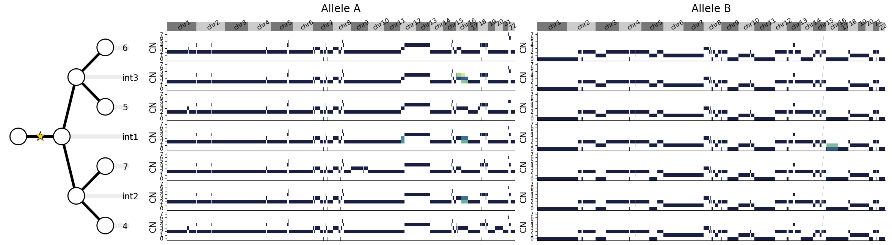
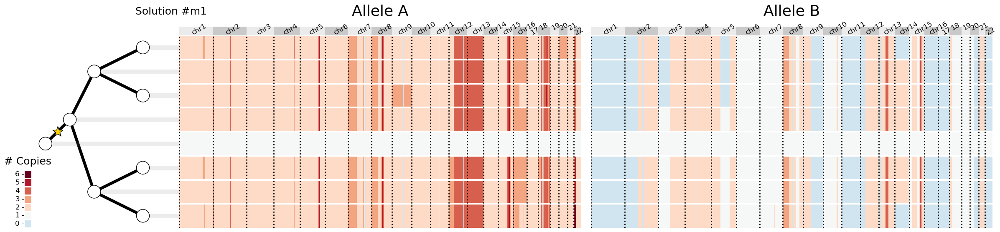

# SPICE <br/> <sub><u>S</u>ubclone <u>P</u>robability <u>I</u>nference of <u>C</u>opy-number <u>E</u>volution</sub> #

SPICE is an algorithm that reconstructs hundreds to thousands of equally plausible CNA phylogenies for each tumor, taking in input clone-specific CNA profiles that can be inferred from either bulk DNA sequencing data using copy-number deconvolution methods, or from single-cell DNA sequencing data by clustering cells inferred with similar CNAs.
Rather than relying on a single, error-prone estimate like previous methods, SPICE leverages the enumeration of multiple equally-plausible CNA phylogenies to quantify uncertainty for each inferred CNA event.

SPICE is under active development and is currently available only as a Python library. However, before final publication, SPICE will be released as a user-friendly standard Bioconda package with automatic installation and standard command-line interface.

## Contents ##

1. [Quick start and demo](#quick)
2. [Installation](#installation)
3. [Usage](#usage)
    1. [Input data](#requireddata)
    2. [Outputs](#outputs)

<a name="quick"></a>
## Quick start and demo

A full repoducible demo of SPICE, with an already reproduced run, is available at:

[SPICE demo](./spice_demo.ipynb)

<a name="installation"></a>
## Installation

SPICE is written in Python3 and will be distributed through [bioconda](https://bioconda.github.io/) (not yet available).
Until final release, SPICE requires a standard `conda` environment, that can be installed locally on any machine using any of the many available distributions, including the reccommended [Miniforge](https://github.com/conda-forge/miniforge), the compact [Miniconda](https://docs.conda.io/en/latest/miniconda.html), or the complete [Anaconda](https://www.anaconda.com/).

The required environment is available within [spice_env.yaml](spice_env.yaml) and can be created using the following command after cloning this repository locally:
```shell
conda env create -f spice_env.yaml -n spice
```

In general and especially in the case of performance issues, the use of `mamba` (available in Miniforge by default and installable in the base environment of any conda distribution) is recommended, replacing `conda create` with `mamba create`.

After the installation, the environment can be activated and SPICE libraries can be executed from within the environment:
```shell
conda activate spice
```

Also, through [Pyomo](https://pyomo.readthedocs.io/en/stable/solving_pyomo_models.html#supported-solvers), SPICE requires the use of [Gurobi](https://www.gurobi.com/) which requires a valid Gurobi license that can be obtained freely for academic research purposes.
To do this, make sure that the environmental variable `GRB_LICENSE_FILE` points to a valid license file (typically with a `.lic` extension). This can be easily obtained depending on the type of free academic license available:

1. **Individual license**. This license can be obtained [easily](http://www.gurobi.com/academia/academia-center) by any academic user with an institutional email. This license is user and machine-specific, meaning that the user needs to require a different license for every used machine. Assuming the license is stored at `/path/to/gurobi.lic`, set the environment variable `GRB_LICENSE_FILE` to point to it:

    ```shell
    export GRB_LICENSE_FILE="/path/to/gurobi.lic"
    ```
2. **Multi-use license**. This license can be used by multiple users on any machine in a cluster. This [license](http://www.gurobi.com/academia/academia-center) can be obtained but needs to be requested by the IT staff of the user's institution. This license is typically used in a machine cluster and only requires the following command (the exact form of this command may vary):
    ```shell
    module load gurobi
    ```

<a name="usage"></a>
## Usage

1. [Required data](#requireddata)
2. [Outputs](#outputs)

<a name="requireddata"></a>
### Required inputs

Inputs to the SPICE main function `run_spice_bootstrap`:

| **Argument** | **Description** |
|----------|-----------------|
|leaves_df | A DataFrame containing copy number profiles and segment information for each leaf (clone). Each row corresponds to a genomic segment with associated copy number data. |
| min_seg_size | The minimum segment size (in base pairs) considered in the ILP model of SPICE. Segments smaller than this threshold undergo phylogenetic reconstruction using the alternative, simpler, evolutionary model (default=0). |
| max_n_segs | The maximum number of segments to include in the ILP model. Segments are ranked in decreasing order of size and the top max_n_segs are included. The other segments undergo phylogenetic reconstruction using the alternative, simpler, evolutionary model. If None, all segments are used. (default=None).|
| keep_consec_segs | Only used when either of min_seg_size or max_n_segs are active. Ensures that any segments contiguous with small segments are kept for ILP inference. (default=False). |
| allele_specific | If True, inference is performed on allele-specific copy number profiles (major/minor). If False, total copy number is used (default=True). |
| phase_alleles | Determines whether alleles should be phased before inference (default=False). |
| leaf_dependent_phasing | If False, phasing is performed independently for each leaf. If True, global phasing is used across all leaves (default=True). |
| max_cn | The maximum copy number per segment. Copy numbers above this threshold are truncated (default=8). |
| verbose | Controls the verbosity of console output. If True, detailed progress and debug messages are printed (default=True). |
| rs | Random seed (default=1). |
| n_threads | The number of computational threads used for parallel execution (default=1). |
| time_limit | The maximum time (in hours) allowed for the inference process to complete (default=5). |
| boot_distfunc | The distance function used for Neighbour Joining when inferring the phylogenetic tree topology. Common options include 'bphamm' (breakpoint Hamming distance) (default='bphamm'). |
| weight_wgd | Whether to assign additional weight (where the weight is equivalent to the max_cn value) to whole genome duplication (WGD) events in the ILP (default=True). |
| wgd_fract_genome | The fraction of each allele that must be affected by a WGD event in achild node to keep the inference of WGD from the ILP model (default=0.5). |
| multiple_solutions | If True, multiple possible phylogenetic solutions are enumerated by SPICE, otherwise only the optimal tree is returned (default=True). |
| solution_pool_size | The number of alternative ancestral node solutions to enumerate from the ILP model (default=1000). |
| n_bootstraps | The number of bootstrap replicates performed inferring phylogenetic tree topologies (default=1000). |
| fixed_topology | If tuple of (parent, child) relationships describing the topology is provided, the tree topology is fixed, and only ancestral nodes are inferred (default=False). |
| topology_prop_limit | The minimum threshold on the proportion of solutions for each topology that must be present to keep in the solution pool (default=0.025). |
| debug | Outputs more detailed information on the model for debugging only (default=False). |
| rank_multiple_trees | If True, multiple inferred trees are ranked according to their probability (default=True). |
| output_type | Specifies the output mode. Options include 'return' (returns results to the session), 'save' (writes results to disk) or 'both' (default='save'). |
| output_dir | Directory to which inference outputs, logs, and plots are saved. If None, results are not written to current directory (default=None). |

<a name="outputs"></a>
### Outputs

Outputs to the SPICE main function `run_spice_bootstrap`:

| **Argument** | **Description** |
|----------|-----------------|
| total_nodes_multisol | The output copy number profiles by SPICE for every solution enumerated in the enumerate ILP. |
| total_edges_multisol | The output edges of the phylogeny by SPICE for every solution enumerated in the enumerate ILP. |
| total_nodes_optimal | The output copy number profiles by SPICE for only the optimal solutions (one for each inferred topology) output by the optimal ILP. |
| total_edges_optimal | The output edges of the phylogeny by SPICE for only the optimal solutions (one for each inferred topology) output by the optimal ILP. |
| total_events | All events in each of the enumerated solutions output by SPICE. This currently includes only events from the ILP, and not those from the alternative, simpler model. |
| solution_probabilities | The calculated probabilities of each topology, CN profile, and over solution probability for every solution enumerated by SPICE, along with the ranking of each solution. |
| chosen_topology_cn_probabilities | The probability of each inferred ancestral copy number state, calculated only for the top-ranked phylogenetic topology. |
| solve_info | Details the information for the ILP solving for every topology and both the optimal and enumerate ILP. Includes run time, solve status and number of CNAs. |
| mapping | A mapping of the input copy number segments to those input to the ILP model (including altered segment names as a result of the filtering and collapsing of segments). |

The outputs can be plotted with the included functions (described in the demo):




