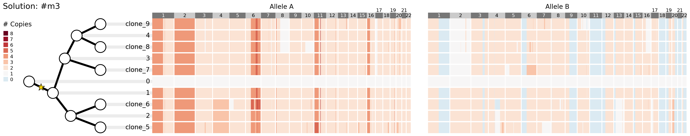
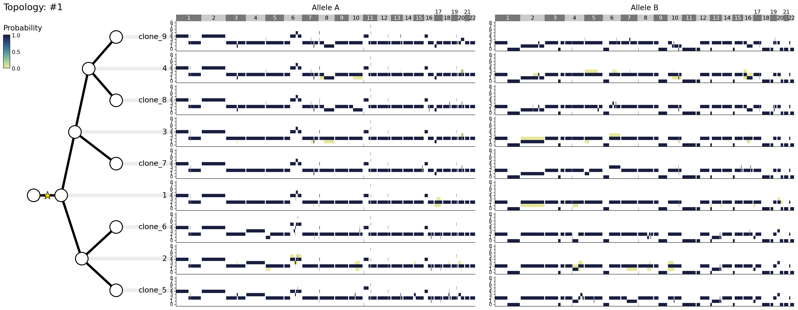

# SPICE <br/> <sub><u>S</u>ubclone <u>P</u>robability <u>I</u>nference of <u>C</u>opy-number <u>E</u>volution</sub> #


SPICE is an algorithm that reconstructs hundreds to thousands of equally plausible CNA phylogenies for each tumor, taking in input clone-specific CNA profiles that can be inferred from either bulk DNA sequencing data using copy-number deconvolution methods, or from single-cell DNA sequencing data by clustering cells inferred with similar CNAs.
Rather than relying on a single, error-prone estimate like previous methods, SPICE leverages the enumeration of multiple equally-plausible CNA phylogenies to quantify uncertainty for each inferred CNA event.

The SPICE algorithm and its applications are described in the related manuscript:
[Bunkum, McGranahan, Jamal-Hanjani & Zaccaria, *Nature Communications*, 2026](https://doi.org/10.1038/s41467-026-79597-0)

This repository includes detailed instructions regarding the requirements, installation, and demos of SPICE.

<br clear="left"/>

## Contents ##

1. [Quick start and demo](#quick)
2. [Installation](#installation)
3. [Usage](#usage)
    - [Command line](#commandline)
    - [Python: inputs](#requireddata)
    - [Outputs](#outputs)

<a name="quick"></a>
## Quick start and demo

A full reproducible demo of SPICE, with an already reproduced run, is available at:

[SPICE demo](demo/spice_demo.ipynb)

<a name="installation"></a>
## Installation

SPICE is written in Python3 and is distributed through [bioconda](https://bioconda.github.io/index.html). Before installing, bioconda needs to be set up correctly by running the following commands. This only needs to be done once and can be skipped if bioconda has already been configured on the machine:
```shell
conda config --add channels bioconda
conda config --add channels conda-forge
conda config --set channel_priority strict
```

SPICE and its required Gurobi solver can then be installed together into a new `conda` environment named `spice` with a single command:
```shell
conda create -n spice -c conda-forge -c bioconda -c gurobi spice gurobi
```

This requires a `conda` distribution, such as the recommended [Miniforge](https://github.com/conda-forge/miniforge), the compact [Miniconda](https://docs.conda.io/en/latest/miniconda.html), or the complete [Anaconda](https://www.anaconda.com/); `mamba` can be used as a faster drop-in replacement for `conda`. Alternatively, the same environment can be created from the provided [environment.yml](environment.yml) with `conda env create -f environment.yml`.

After installation, the environment is activated with:
```shell
conda activate spice
```
SPICE can then be run through the `spice` command-line interface or imported as a Python library (see the [demo](demo/spice_demo.ipynb)).

Also, through [Pyomo](https://pyomo.readthedocs.io/en/stable/solving_pyomo_models.html#supported-solvers), SPICE requires the use of [Gurobi](https://www.gurobi.com/) (installed by the command above from the `gurobi` channel), which requires a valid Gurobi license that can be obtained freely for academic research purposes.
To do this, make sure that the environmental variable `GRB_LICENSE_FILE` points to a valid license file (typically with a `.lic` extension). This can be easily obtained depending on the type of free academic license available:

1. **Individual license**. This license can be obtained [easily](http://www.gurobi.com/academia/academia-center) by any academic user with an institutional email. This license is user and machine-specific, meaning that the user needs to require a different license for every used machine. Assuming the license is stored at `/path/to/gurobi.lic`, set the environment variable `GRB_LICENSE_FILE` to point to it:

    ```shell
    export GRB_LICENSE_FILE="/path/to/gurobi.lic"
    ```
2. **Multi-use license**. This license can be used by multiple users on any machine in a cluster. This [license](http://www.gurobi.com/academia/academia-center) can be obtained but needs to be requested by the IT staff of the user's institution. This license is typically used in a machine cluster and only requires the following command (the exact form of this command may vary):
    ```shell
    module load gurobi
    ```

<a name="usage"></a>
## Usage

1. [Command line](#commandline)
2. [Python: inputs](#requireddata)
3. [Outputs](#outputs)

<a name="commandline"></a>
### Command line

SPICE takes a table (TSV or CSV) of clone-specific copy number profiles, with one row per segment and clone and the columns `Node`, `Chr`, `Start`, `End`, `Allele` (`A` / `B`) and `CN`:
```shell
spice demo/sim/sim_cn_seg_leaf_profiles.tsv.gz -o results/ -j 4
```

Main options:

| **Option** | **Description** |
|----------|-----------------|
| `-o`, `--output` | Output directory for the result tables and plots (default=./spice_output). |
| `--total-cn` | Infer on total copy number instead of allele-specific profiles. |
| `--max-cn` | Maximum copy number per segment; higher values are truncated (default=8). |
| `--solution-pool-size` | Number of alternative solutions to enumerate, shared between the topologies in proportion to their bootstrap frequency (default=1000). |
| `--n-bootstraps` | Number of bootstrap replicates used to infer candidate topologies (default=1000). |
| `-j`, `--jobs` | Number of parallel threads (default=all available cores). |
| `--time-limit` | Maximum run time of the ILP solving, in hours (default=5). |
| `--seed` | Random seed (default=1). |
| `--verbose` | Print detailed logging, including the Gurobi log. |

Advanced options come after the `dev` subcommand, and are listed with `spice DATA dev -h`, e.g.:
```shell
spice profiles.tsv -o results/ dev --min-seg-size 5e6 --phase-alleles
```

Besides the output tables, SPICE saves two plots of the top-ranked solution: its copy number profiles (`spice_cn_profiles.png`) and the copy number probabilities of its topology (`spice_cn_probabilities.png`). Use `dev --plot-solution-id m2` to plot another solution, or `dev --no-plot` to skip the plots.

<a name="requireddata"></a>
### Python: inputs

SPICE's main Python function is `run_spice_bootstrap`:
```python
from spice.libs.spice_bootstrap import run_spice_bootstrap
```

| **Argument** | **Description** |
|----------|-----------------|
| `leaves_df` | A DataFrame of leaf (clone) copy number profiles, with one row per leaf, chromosome, allele and segment, and the columns `Node`, `Chr`, `Start`, `End`, `Allele` (`A` / `B`) and `CN`. In total copy number mode, `Allele` may be left out; if given, alleles A and B are summed. Every leaf must have the same segments. Other columns are ignored. |
| `min_seg_size` | Segments smaller than this (in base pairs) are reconstructed with the simpler focal evolutionary model instead of the ILP. Ignored when max_n_segs is given (default=5e4). |
| `max_n_segs` | Only the max_n_segs largest segments are used in the ILP; the rest are reconstructed with the focal evolutionary model. In allele-specific mode each allele counts as a segment, but both alleles of a segment are kept together. If None, min_seg_size is used instead (default=None). |
| `keep_consec_segs` | Moves small segments into the ILP so that every segment left to the focal evolutionary model has a neighbouring segment in the ILP (default=False). |
| `allele_specific` | If True, each allele's copy number is modelled separately; if False, total copy number is modelled throughout the tree (default=True). |
| `phase_alleles` | Whether to phase alleles before inference, with the phasing algorithm of CHISEL (default=False). |
| `leaf_dependent_phasing` | If False, phasing is performed independently for each leaf. If True, global phasing is used across all leaves (default=True). |
| `max_cn` | The maximum copy number per segment in the ILP. Copy numbers above this threshold are truncated (default=8). |
| `focal_max_cn` | The maximum copy number in the focal evolutionary model. If None, max_cn is used (default=None). |
| `verbose` | If True, logs detailed progress messages and prints the Gurobi log (default=False). |
| `rs` | Random seed for the bootstrapping and the ILP solver (default=1). |
| `n_threads` | The number of threads for the ILP solver, and of worker processes for the bootstrapping and the focal evolutionary model (default=1). |
| `time_limit` | The time limit (in hours) for the ILP solves, shared between the topologies (default=5). |
| `weight_wgd` | Whether to give whole genome duplication (WGD) events a weight of max_cn (the highest possible event amplitude) in the ILP objective and the bootstrap distances (default=True). |
| `wgd_fract_genome` | The minimum fraction of each allele (or of the genome, in total copy number mode) that must be affected by WGD for a WGD inferred by the ILP to be kept (default=0.5). |
| `multiple_solutions` | If True, alternative solutions are enumerated; otherwise only the optimal solution of the topology with the lowest cost is returned (default=True). |
| `solution_pool_size` | The number of alternative solutions to enumerate, shared between the topologies in proportion to their bootstrap frequency (default=1000). |
| `max_cutoff` | Only solutions with a cost of at most this multiple of the optimal cost are enumerated (default=2). |
| `n_bootstraps` | The number of bootstrap replicates used to infer candidate topologies. Ignored with fixed_topology (default=1000). |
| `fixed_topology` | A tuple of (parent, child) edges. If given, the topology is fixed and only the ancestral copy numbers are inferred (default=False). |
| `topology_prop_limit` | The minimum fraction of bootstrap replicates that must give a topology for it to be used, in addition to the topology_topn most frequent topologies (default=0.025). |
| `topology_topn` | The number of most frequent bootstrapped topologies that are always used (default=10). |
| `initnodes` | Copy number profiles of the internal nodes (e.g. from MEDICC2) to warm-start the ILP, with the same columns and segments as leaves_df. Requires fixed_topology (default=None). |
| `debug` | Also outputs every ILP variable, the topologies used and the position mapping, for debugging (default=False). |
| `rm_small_segs` | If True, small segments (set by min_seg_size or max_n_segs) are removed instead of being reconstructed with the focal evolutionary model (default=False). |
| `rank_multiple_trees` | If True, the solutions are ranked by their probability. Ignored if multiple_solutions is False (default=True). |
| `output_type` | Specifies the output mode. Options include 'return' (returns results to the session), 'save' (writes results to disk) or 'both' (default='save'). |
| `output_dir` | Directory to which the outputs, the log and the Gurobi node files are saved; created if it doesn't exist. If None, the current directory is used (default=None). |

<a name="outputs"></a>
### Outputs

`run_spice_bootstrap` returns the outputs as a dictionary of DataFrames (with `output_type='return'` or `'both'`) and saves them to `output_dir` under the file names in brackets (with `'save'` or `'both'`), together with the log `spice.log`. The command line always saves them. Solutions are named `o<n>` (the optimal solution of topology n) and `m<n>` (the alternative enumerated solutions), and `tree_id` is the topology.

| **Output** [file name] | **Description** |
|----------|-----------------|
| [total_nodes_optimal](docs/total_nodes_optimal.md) [`spice_total_nodes_optimal.tsv.gz`] | One row per optimal solution (one per topology), node and merged segment (consecutive input segments with the same copy numbers in every leaf), with each allele's copy number and the gains and losses on the branch into the node. |
| [total_nodes_multisol](docs/total_nodes_multisol.md) [`spice_total_nodes.tsv.gz`] | The same as `total_nodes_optimal` but for all enumerated solutions. |
| [total_edges_optimal](docs/total_edges_optimal.md) [`spice_total_edges_optimal.tsv.gz`] | One row per optimal solution and edge, with the number of events and WGD on the edge, and the solution's costs. |
| [total_edges_multisol](docs/total_edges_multisol.md) [`spice_total_edges.tsv.gz`] | The same as `total_edges_optimal` but for all enumerated solutions. |
| [total_events](docs/total_events.md) [`spice_total_events.tsv.gz`] | One row per copy number event in the alternative enumerated solutions, with its node, allele, type, coordinates and amplitude, including the events of the focal evolutionary model if small segments were reconstructed with it. |
| [solution_probabilities](docs/solution_probabilities.md) [`spice_solutions_ranked.tsv.gz`] | One row per alternative enumerated solution, with its topology, copy number and overall log probabilities, its rank (`solution_rank`) and its topology's rank (`topology_rank`); 1 is the most probable. |
| [cn_probabilities](docs/cn_probabilities.md) [`spice_cn_probabilities.tsv.gz`] | For each topology, the probability of each copy number of each internal node, merged segment and allele. `top_ranked_topology` marks the most probable topology, and `top_ranked_solution` the topology of the top-ranked solution. |
| [solve_info](docs/solve_info.md) [`spice_solve_info.tsv`] | The solve time, status, gap and cost of each topology's ILPs, plus the total run time and random seed. |
| [total_debug](docs/total_debug.md) [`spice_debug.tsv.gz`] | Only with `debug=True`: the value of every ILP variable in each solution. |
| [topologies](docs/topologies.md) [`spice_topologies.tsv.gz`] | Only with `debug=True`: the edges of each topology used, with its bootstrap frequency. |
| [mapping](docs/mapping.md) [`spice_mapping.tsv.gz`] | Only with `debug=True`: how the input segments map to the segments used in the ILP. |

The outputs can be plotted with `plot_cn_tree`, which shows the copy number profiles of one solution, and `plot_cn_probabilities`, which shows the copy number probabilities of one topology (see the [demo](demo/spice_demo.ipynb)). The command line saves both plots for the top-ranked solution.
```python
from spice.libs.plotting.tree import plot_cn_tree, plot_cn_probabilities
```

